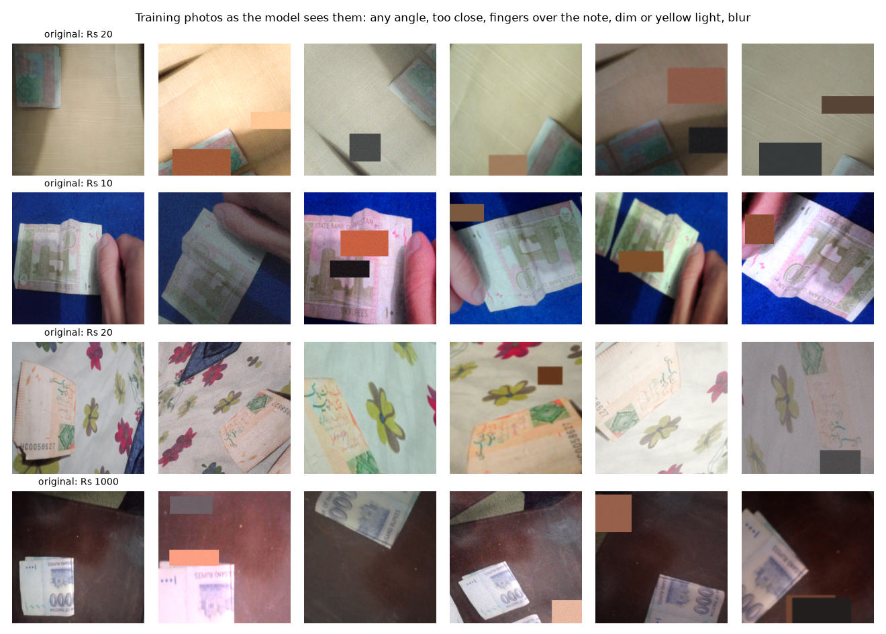

# Pakistani Banknote Reader

[](https://github.com/Hassan-Ali-Mehdi-3024/boltanote/actions/workflows/test.yml)
 

**A talking banknote reader for blind people in Pakistan. Point the phone camera at a note; it says the value out loud in Urdu (or English). Runs in any phone browser, offline once loaded.**

[Live demo](https://boltanote.vercel.app) · [Report (PDF)](https://boltanote.vercel.app/report.pdf) · [Slides](https://boltanote.vercel.app/slides.pdf) · [Video](https://youtu.be/P0O-qhMldGI) · [LinkedIn: not posted](#linkedin) · [Dataset (Kaggle)](https://www.kaggle.com/datasets/rafayqayyum/pakistan-image-currency-dataset) · [Model card](model_card.json)

Deep Learning semester project, BSCS-7A, Superior University, Lahore. Instructor: Dr. Munir Ahmad. Author: Hassan Ali Mehdi.



## Results

| Model | Params | Test | Other photographers | Wrong value said (test / other) | CPU ms |
|---|---|---|---|---|---|
| CNN from scratch | 2.36M | 99.6% | 82.5% | 0.0% / 4.8% | 88 |
| MobileNetV3-Large **(deployed)** | 4.22M | 100.0% | 92.1% | 0.0% / 0.0% | 15 |
| MobileNetV4-Conv-Medium | 8.45M | 99.9% | 92.1% | 0.0% / 0.0% | 37 |

- Deployed: **MobileNetV3-Large**, chosen on validation accuracy.
- Same-dataset test: 100.0% of 727 unseen photos. **Other photographers** (63 photos): 92.1%.
- The app speaks only when the top value's probability is ≥ **0.68** (and 3 frames agree). That threshold keeps wrong values ≤ 1 in 500 (0.2%) on a stress-tested validation set (each validation photo × 4 augmentations); no test photo was used to set it.
- **Duplicate check:** 339 of 402 test photos in the second public dataset are near-copies (perceptual hash ≤ 8 bits) of the training dataset's photos; only 63 are used as the external test.

## Test it in 3 commands

```bash
git clone https://github.com/Hassan-Ali-Mehdi-3024/boltanote && cd boltanote
pip install -r requirements.txt          # or just: pip install numpy pillow onnxruntime
python evaluate.py                       # 16 bundled, labelled photos in samples/
```

```bash
python predict.py samples/500_front_1.jpg            # value, probability, what it would say

```

`predict.py` output for `samples/500_front_1.jpg` (real):

```json
{
 "value": "500",
 "probability": 0.8381,
 "side": "front",
 "speaks": true,
 "says": {
  "ur": "پانچ سو روپے",
  "en": "Five hundred rupees"
 },
 "value_probabilities": {
  "10": 0.0295,
  "20": 0.0231,
  "50": 0.0224,
  "100": 0.0326,
  "500": 0.8381,
  "1000": 0.0285,
  "5000": 0.016,
  "none": 0.0097
 }
}
```

## Weights

| File | What | Load with |
|---|---|---|
| `weights/boltanote.onnx` | deployed model, outputs `probs` [1,15] | `onnxruntime.InferenceSession(...)` |
| `weights/boltanote_torchscript.pt` | same model, TorchScript | `torch.jit.load(...)` |
| `weights/<model>.pt` | PyTorch checkpoints of all three models | `boltanote.models.load_checkpoint(...)` |

Input: the whole photo, upright, squeezed to 224×224 RGB, float32 in [0, 1], shape `[1, 3, 224, 224]`; normalisation is inside the model. 15 classes: each of Rs 10, 20, 50, 100, 500, 1000, 5000 front and back, plus `none`; add front + back for the value. SHA-256 of every file: [model_card.json](model_card.json).

## Data

| Source | Use | Licence |
|---|---|---|
| [Pakistan Image Currency Dataset](https://www.kaggle.com/datasets/rafayqayyum/pakistan-image-currency-dataset) (3,611 note photos + 280 others) | train / val / test, 70/15/15 per class, near-copies kept together | CC0 |
| [Imagenette](https://github.com/fastai/imagenette) (1,000 photos) | extra "no note" photos | Apache-2.0 |
| [Pakistani Currency Notes Dataset](https://www.kaggle.com/datasets/muhammadasjadali/pakistani-currency-notes) (63 photos after de-duplication) | external test only | CC BY 4.0 |


Exact files: [`data/splits.csv`](data/splits.csv). Rebuild: `bash scripts/get_data.sh data_raw && python scripts/make_splits.py --data data_raw`.

## Method

Three models, identical data and recipe (AdamW, cosine schedule, label smoothing 0.1, GPU augmentation built around how blind users hold notes: any rotation, too close, partly out of frame, fingers, dim/yellow light, blur; no mirror flips):

1. `cnn_scratch`: 5-block CNN from random weights
2. `mobilenetv3_large`: MobileNetV3-Large (2019), ImageNet-pretrained
3. `mobilenetv4_conv_medium`: MobileNetV4-Conv-Medium (2024), ImageNet-pretrained

## Reproduce

Training ran on one NVIDIA L4 in Google Colab: [`notebooks/BoltaNote_train.ipynb`](notebooks/BoltaNote_train.ipynb) (all outputs kept).

```bash
bash scripts/get_data.sh data_raw
python train.py --data data_raw --model mobilenetv3_large --out outputs     # ~2 min on an L4
python report.py --runs outputs --data data_raw       # weights/, figures, model card
```

## Repository

```
predict.py  evaluate.py          inference (numpy + pillow + onnxruntime only)
train.py  report.py              training, export, threshold calibration, figures
boltanote/                       models, data, augmentation, metrics
data/splits.csv
weights/                         ONNX, TorchScript, PyTorch checkpoints
samples/                         16 labelled test photos
results/                         metrics, per-photo predictions, figures, duplicate check
docs/                            report (PDF + HTML), slides (PPTX, PDF), voiceover script
site/  scripts/build_site.py     the website (deployed on Vercel from web/); site/audio = Urdu/English voice clips
notebooks/                       executed Colab training notebook
```

## Every link, with an alternate

Every part of the project is on two separate hosts, so one outage never breaks a link.

| What | Main link | Alternate link |
|---|---|---|
| This website | [boltanote.vercel.app](https://boltanote.vercel.app) | [hassan-ali-mehdi-3024.github.io/boltanote/](https://hassan-ali-mehdi-3024.github.io/boltanote/) |
| GitHub repository | [github.com/Hassan-Ali-Mehdi-3024/boltanote](https://github.com/Hassan-Ali-Mehdi-3024/boltanote) | [boltanote.vercel.app/downloads/boltanote-source.zip](https://boltanote.vercel.app/downloads/boltanote-source.zip) |
| Video presentation (YouTube) | [youtu.be/P0O-qhMldGI](https://youtu.be/P0O-qhMldGI) | [boltanote.vercel.app/video/pakistani-banknote-reader-film.mp4](https://boltanote.vercel.app/video/pakistani-banknote-reader-film.mp4) |
| Report (PDF) | [boltanote.vercel.app/report.pdf](https://boltanote.vercel.app/report.pdf) | [github.com/Hassan-Ali-Mehdi-3024/boltanote/raw/main/docs/BoltaNote_report.pdf](https://github.com/Hassan-Ali-Mehdi-3024/boltanote/raw/main/docs/BoltaNote_report.pdf) |
| Report (web page) | [boltanote.vercel.app/report/](https://boltanote.vercel.app/report/) | [hassan-ali-mehdi-3024.github.io/boltanote/report/](https://hassan-ali-mehdi-3024.github.io/boltanote/report/) |
| Presentation slides (PDF) | [boltanote.vercel.app/slides.pdf](https://boltanote.vercel.app/slides.pdf) | [github.com/Hassan-Ali-Mehdi-3024/boltanote/raw/main/docs/slides/BoltaNote_slides.pdf](https://github.com/Hassan-Ali-Mehdi-3024/boltanote/raw/main/docs/slides/BoltaNote_slides.pdf) |
| Model weights (ONNX) | [github.com/Hassan-Ali-Mehdi-3024/boltanote/raw/main/weights/boltanote.onnx](https://github.com/Hassan-Ali-Mehdi-3024/boltanote/raw/main/weights/boltanote.onnx) | [boltanote.vercel.app/model/boltanote.onnx](https://boltanote.vercel.app/model/boltanote.onnx) |
| Model weights (TorchScript) | [github.com/Hassan-Ali-Mehdi-3024/boltanote/raw/main/weights/boltanote_torchscript.pt](https://github.com/Hassan-Ali-Mehdi-3024/boltanote/raw/main/weights/boltanote_torchscript.pt) | [github.com/Hassan-Ali-Mehdi-3024/boltanote/releases/download/v1.0/boltanote_torchscript.pt](https://github.com/Hassan-Ali-Mehdi-3024/boltanote/releases/download/v1.0/boltanote_torchscript.pt) |
| PyTorch checkpoints | [github.com/Hassan-Ali-Mehdi-3024/boltanote/tree/main/weights](https://github.com/Hassan-Ali-Mehdi-3024/boltanote/tree/main/weights) | [github.com/Hassan-Ali-Mehdi-3024/boltanote/releases/tag/v1.0](https://github.com/Hassan-Ali-Mehdi-3024/boltanote/releases/tag/v1.0) |
| Training notebook | [github.com/Hassan-Ali-Mehdi-3024/boltanote/blob/main/notebooks/BoltaNote_train.ipynb](https://github.com/Hassan-Ali-Mehdi-3024/boltanote/blob/main/notebooks/BoltaNote_train.ipynb) | [boltanote.vercel.app/notebooks/BoltaNote_train.ipynb](https://boltanote.vercel.app/notebooks/BoltaNote_train.ipynb) |
| Data splits (CSV) | [github.com/Hassan-Ali-Mehdi-3024/boltanote/blob/main/data/splits.csv](https://github.com/Hassan-Ali-Mehdi-3024/boltanote/blob/main/data/splits.csv) | [boltanote.vercel.app/data/splits.csv](https://boltanote.vercel.app/data/splits.csv) |
| Main dataset | [www.kaggle.com/datasets/rafayqayyum/pakistan-image-currency-dataset](https://www.kaggle.com/datasets/rafayqayyum/pakistan-image-currency-dataset) | [github.com/Hassan-Ali-Mehdi-3024/boltanote/releases/download/v1.0/pakistan-image-currency-dataset.zip](https://github.com/Hassan-Ali-Mehdi-3024/boltanote/releases/download/v1.0/pakistan-image-currency-dataset.zip) |
| External test set | [www.kaggle.com/datasets/muhammadasjadali/pakistani-currency-notes](https://www.kaggle.com/datasets/muhammadasjadali/pakistani-currency-notes) | [github.com/Hassan-Ali-Mehdi-3024/boltanote/releases/download/v1.0/pakistani-currency-notes-roboflow.zip](https://github.com/Hassan-Ali-Mehdi-3024/boltanote/releases/download/v1.0/pakistani-currency-notes-roboflow.zip) |
| "No note" photos (Imagenette) | [github.com/fastai/imagenette](https://github.com/fastai/imagenette) | [s3.amazonaws.com/fast-ai-imageclas/imagenette2-160.tgz](https://s3.amazonaws.com/fast-ai-imageclas/imagenette2-160.tgz) |
| Model card (JSON) | [boltanote.vercel.app/model_card.json](https://boltanote.vercel.app/model_card.json) | [github.com/Hassan-Ali-Mehdi-3024/boltanote/raw/main/model_card.json](https://github.com/Hassan-Ali-Mehdi-3024/boltanote/raw/main/model_card.json) |
| Project summary (JSON) | [boltanote.vercel.app/project.json](https://boltanote.vercel.app/project.json) | [hassan-ali-mehdi-3024.github.io/boltanote/project.json](https://hassan-ali-mehdi-3024.github.io/boltanote/project.json) |

### LinkedIn

Due to legal commitments with the company where I work, I can't use my LinkedIn for personal use while I'm employed there.

## Limits

A few physical notes per value in training; 2005–2008 note designs only (the State Bank's new series will need new photos); one note at a time; not a counterfeit detector.

## Credits

Data: Pakistan Image Currency Dataset (Kaggle, CC0), Imagenette (fast.ai), Pakistani Currency Notes Dataset (Roboflow, CC BY 4.0). Models: timm (Ross Wightman). Voice: Microsoft Edge neural voices (ur-PK Uzma, en-IN Neerja). Code: MIT licence.
